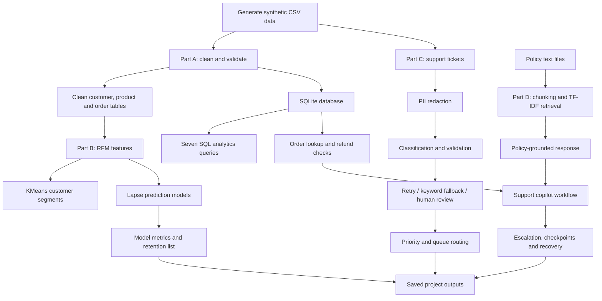

# Instamart Customer Intelligence & Support Copilot

**End-to-end capstone project | Data Engineering · SQL Analytics · Customer Segmentation · Lapse Prediction · Ticket Triage · Retrieval-Augmented Support**

This project builds an offline prototype for two connected business needs in a quick-commerce setting:

1. **Customer intelligence:** transform raw customer, product, and order data into reliable analytical datasets; understand customer value and engagement; and identify customers who may lapse.
2. **Customer support intelligence:** classify incoming support tickets, route them to the right team, retrieve relevant policy information, inspect order records, and apply safe refund/escalation rules.

The implementation is organized into four parts (A–D) and can be executed end-to-end with one command.

> **Important:** All Instamart-style records are synthetic and generated for this capstone. They are not actual Instamart customer or operational data. The LLM behavior is simulated locally by `mock_llm.py`; no external LLM API, API key, or network connection is needed.

---

## 1. Executive summary

The project converts raw transactional and support data into practical outputs for analytics and customer operations.

| Business need | Implemented solution | Result produced |
|---|---|---|
| Raw data may contain duplicates, inconsistent values, and missing fields | Data-cleaning and validation pipeline | Clean customer, product, and order tables plus SQLite database |
| Teams need to understand customer value and engagement | RFM feature engineering, KMeans clustering, and PCA exploration | Four interpretable customer groups |
| Teams need to identify customers who may stop ordering | Supervised lapse classification with model comparison | Selected Logistic Regression pipeline and ranked retention candidates |
| Support tickets need consistent categorization and routing | PII redaction, mock classification, response validation, retries, fallback, and routing | Ticket triage CSV and queue assignments |
| Support agents need policy-aware responses and safe order actions | TF-IDF retrieval, order lookup, refund eligibility checks, escalation, and checkpoint recovery | Scenario logs, refund ledger, and state checkpoints |

### Solution outcome from the included run

The repository includes generated output files from a completed run. The results below are read from those artifacts:

- **1,200 customers** are represented in `outputs/customer_segments.csv`.
- Customer segmentation produced **473 Loyal**, **404 Regular**, **196 Premium**, and **127 At Risk** customers.
- The lapse model comparison selected **Oversampled Logistic Regression**, with test-set **F1 = 0.538**, the highest F1 among the three recorded candidates.
- The triage output contains **164 tickets**: 140 classified through JSON output, 12 through keyword fallback, 9 flagged for invalid output, and 3 skipped because the message was empty.
- Ticket routing in that output: 97 to `support_queue`, 41 to `security_team`, 14 to `premium_desk`, and 12 to `human_review`.
- The copilot scenario log demonstrates human review for unverifiable late-delivery claims, escalation for suspected fraud/safety concerns, denial for cancelled orders, not-found handling, and maximum-iteration fallback.

These results are specific to the included synthetic data and the saved run artifacts. They are demonstration results, not production performance claims.

---

## 2. Business problem

Quick-commerce services handle frequent orders and a high volume of customer interactions. Teams need reliable information to answer questions such as:

- Which customers are high-value, loyal, or potentially at risk?
- Which customers should be prioritized for retention outreach?
- What type of issue is a customer reporting: billing, delivery, technical, or fraud?
- Which team should handle a ticket?
- What does the policy say about a refund or delivery issue?
- Is an order eligible for an action, or should it be referred to a human specialist?

The project addresses these questions with a small, reproducible analytics and support workflow. It deliberately keeps human review in the loop when required information is missing or a safety concern is detected.

## 3. Project objectives

1. Generate a consistent synthetic dataset for customers, products, orders, and support tickets.
2. Clean and validate the data before analysis.
3. Store cleaned tables in SQLite and demonstrate useful business SQL.
4. Build customer-level RFM features and group customers into segments.
5. Train and compare classification models for customer lapse prediction.
6. Redact personally identifiable information (PII) from ticket text before classification.
7. Categorize tickets and route them according to category and customer segment.
8. Retrieve relevant policy passages and use them to support customer-service responses.
9. Add checks around order status, refund amount, missing data, human escalation, and agent recovery.
10. Save outputs so that the workflow can be inspected and reproduced.

---

## 4. End-to-end solution architecture



### Pipeline execution

`run_all.py` is the main orchestrator. It runs the data-generation step and then executes Parts A, B, C, and D. Outputs are stored in:

- `data/` — raw data, cleaned data, and SQLite database.
- `outputs/` — model artifacts, metrics, triage results, agent logs, and refund ledger.
- `state/` — agent checkpoint files used in recovery scenarios.

---

## 5. Repository structure

```text
instamart-customer-intelligence-copilot/
├── data/
│   ├── raw/
│   │   ├── customers.csv
│   │   ├── products.csv
│   │   ├── orders.csv
│   │   └── tickets.csv
│   ├── clean/
│   │   ├── customers.csv
│   │   ├── products.csv
│   │   └── orders.csv
│   └── instamart.db
├── outputs/
│   ├── customer_segments.csv
│   ├── lapse_model_metrics.csv
│   ├── lapse_model.joblib
│   ├── retention_list.csv
│   ├── triage_results.csv
│   ├── triage_budget_demo.csv
│   ├── agent_runs.jsonl
│   └── refund_ledger.jsonl
├── sql/
│   └── queries.sql
├── src/
│   ├── common.py
│   ├── part_a.py
│   ├── part_b.py
│   ├── part_c.py
│   └── part_d.py
├── state/
│   └── scenario checkpoint JSON files
├── generate_data.py
├── mock_llm.py
├── run_all.py
├── requirements.txt
└── README.md
```

### Main files

- `generate_data.py`: creates the deterministic synthetic input data.
- `run_all.py`: runs the full capstone workflow.
- `mock_llm.py`: provides local mock model responses for reproducible demonstrations.
- `src/common.py`: shared project paths and utilities.
- `src/part_a.py`: data cleaning, database creation, and validation.
- `src/part_b.py`: RFM segmentation, PCA, lapse model training, and retention ranking.
- `src/part_c.py`: PII redaction, ticket classification, fallback handling, and routing.
- `src/part_d.py`: policy retrieval, order/refund tools, agent scenarios, and recovery.
- `sql/queries.sql`: seven SQL examples.

---

## 6. Technology stack

| Technology | Purpose |
|---|---|
| Python | Project implementation and orchestration |
| pandas | Data cleaning, feature engineering, and CSV handling |
| NumPy | Numerical operations |
| scikit-learn | Scaling, KMeans, PCA, classification, cross-validation, TF-IDF, and cosine similarity |
| SQLite | Relational storage and order lookup |
| SQL | Business analytics queries |
| joblib | Saving the selected machine-learning pipeline |
| JSON / JSONL | Agent checkpoints, scenario logs, and simulated refund ledger |
| mock LLM | Deterministic offline simulation of model responses |

---

## 7. Installation and execution

### Prerequisites

- Python 3.11 or later
- pip
- Git (optional, if cloning the repository)

### Clone the repository

Replace the placeholder with the GitHub account that owns the repository:

```bash
git clone https://github.com/<your-username>/instamart-customer-intelligence-copilot.git
cd instamart-customer-intelligence-copilot
```

Or download the ZIP from GitHub and extract it.

### Create a virtual environment

**Windows PowerShell**
```powershell
python -m venv .venv
.venv\Scripts\Activate.ps1
```

**Windows Command Prompt**
```bat
python -m venv .venv
.venv\Scripts\activate.bat
```

**macOS / Linux**
```bash
python3 -m venv .venv
source .venv/bin/activate
```

### Install requirements

```bash
python -m pip install --upgrade pip
pip install -r requirements.txt
```

### Run the complete project

```bash
python run_all.py
```

The orchestrator generates the synthetic data and executes all four parts. To run the generator separately:

```bash
python generate_data.py
```

### Run one part at a time

Run these commands from the repository root. Part A should be run first because it creates the cleaned data and database used by later modules.

```bash
python -m src.part_a
python -m src.part_b
python -m src.part_c
python -m src.part_d
```

### Where to find the results

- Cleaned datasets: `data/clean/`
- SQLite database: `data/instamart.db`
- SQL examples: `sql/queries.sql`
- Segments and model results: `outputs/customer_segments.csv`, `outputs/lapse_model_metrics.csv`
- Retention candidates: `outputs/retention_list.csv`
- Ticket results: `outputs/triage_results.csv`
- Copilot scenarios and simulated actions: `outputs/agent_runs.jsonl`, `outputs/refund_ledger.jsonl`
- Checkpoints: `state/`

---

# 8. Part A — Data cleaning, validation, and SQL analytics

## 8.1 Problem addressed

Raw operational data is often not immediately suitable for analytics. Duplicate records, inconsistent categorical values, invalid dates, missing amounts, and invalid delivery durations can distort business reporting and model features.

## 8.2 Implemented solution

Part A reads the raw customer, product, and order CSV files and creates cleaned versions.

The implemented preparation includes:

- Standardizing city and gender values.
- Parsing date and numeric fields.
- Removing exact duplicate records and duplicate order IDs.
- Deriving missing order amounts from product price, quantity, and discount when the required values are available.
- Removing invalid negative delivery durations.
- Filling missing delivery duration for completed orders using category-level medians; cancelled orders retain missing delivery duration.
- Joining product category information to orders where needed for category-based cleaning.

The cleaned tables are saved under `data/clean/`.

## 8.3 Database solution

The cleaned customer, product, and order tables are loaded into `data/instamart.db`, a local SQLite database. This provides a consistent relational source for SQL analysis and order lookups used by the support copilot.

## 8.4 Validation solution

The Part A validation checks include:

- Expected customer and product counts.
- Unique order IDs.
- Non-missing order amounts.
- Valid age values.
- Allowed gender categories.
- No negative delivery durations.
- Creation of the expected SQLite tables.

A successful run prints:

```text
ALL CHECKPOINTS PASSED
```

The script also prints duplicate counts, cleaned order counts, completed/cancelled order counts, and completed-order revenue in INR.

## 8.5 SQL business questions solved

`sql/queries.sql` contains seven queries:

| Query | Business question | SQL technique |
|---|---|---|
| Q1 | Which customers have at least 15 completed orders? | JOIN, GROUP BY, HAVING |
| Q2 | Which city and product-category combinations generate the most completed-order revenue? | Multi-table JOIN and aggregation |
| Q3 | Which products are priced above the catalogue average? | Scalar subquery |
| Q4 | Which customers have no completed orders? | NOT EXISTS anti-join |
| Q5 | Which customers spend more than the average customer spend? | CTE and subquery |
| Q6 | How do customers rank by completed-order spend within each city? | CTE and RANK window function |
| Q7 | How does completed revenue accumulate day by day? | Date aggregation and cumulative SUM window function |

### Part A solution value

The outcome is a validated, queryable dataset rather than raw CSVs alone. This cleaned data is reused in Part B for customer-level analytics and in Part D for order lookup and refund safeguards.

---

# 9. Part B — Customer segmentation and lapse prediction

Part B answers two questions:

1. What types of customers does the business have?
2. Which previously active customers may have lapsed and could be considered for retention outreach?

## 9.1 RFM feature engineering

RFM stands for:

- **Recency:** number of days since the customer's most recent completed order.
- **Frequency:** number of distinct completed orders.
- **Monetary:** total amount spent on completed orders.

The recency reference date in this project is **2025-10-01**. RFM values are calculated at customer level using completed orders.

## 9.2 Customer segmentation solution

The RFM variables are scaled and passed to KMeans with four clusters (`random_state=42`, `n_init=10`). PCA is also used to create a two-component projection for exploratory analysis.

The resulting cluster IDs are mapped to descriptive labels based on their profiles. The included `customer_segments.csv` contains 1,200 customers.

### Segment results in the included output

| Segment | Customers | Interpretation |
|---|---:|---|
| Loyal | 473 | Customers with comparatively recent and repeat purchasing activity |
| Regular | 404 | Customers with a more moderate purchasing pattern |
| Premium | 196 | Higher-value / higher-frequency customers identified by the segment profile |
| At Risk | 127 | Customers with comparatively high recency and weaker recent engagement |
| **Total** | **1,200** | |

The segment names are descriptive interpretations of this generated dataset. Cluster IDs are not inherently ordered and may change if the data or clustering configuration changes.

## 9.3 Lapse prediction problem definition

The model cohort includes customers with at least one completed order before **2025-09-01**.

- **Feature window:** completed-order history before 2025-09-01.
- **Label window:** 2025-09-01 through 2025-09-30.
- **Lapsed label:** a customer is marked lapsed if they have no completed order during the label window.

Customer-level order features are aggregated from the pre-cutoff history and combined with customer attributes and the most frequent product category.

## 9.4 Model training and selection solution

The project compares:

1. Logistic Regression with hyperparameter search.
2. Random Forest with hyperparameter search.
3. Logistic Regression trained with random oversampling applied only to the training data.

The workflow uses a stratified train/test split, preprocessing pipelines, cross-validation with F1 scoring, and test-set metrics. The oversampled candidate is evaluated on the original, unchanged test set. The selected pipeline is saved to `outputs/lapse_model.joblib` and reloaded to check prediction parity.

### Actual saved model metrics

The values below are taken from `outputs/lapse_model_metrics.csv`:

| Model | Accuracy | Precision | Recall | F1 |
|---|---:|---:|---:|---:|
| Logistic Regression | 0.517 | 0.482 | 0.354 | 0.408 |
| Random Forest | 0.517 | 0.472 | 0.221 | 0.301 |
| **Oversampled Logistic Regression** | **0.542** | **0.512** | **0.566** | **0.538** |

**Selected model: Oversampled Logistic Regression**, because it has the highest F1 score (0.538) among the three recorded candidates.

F1 balances precision and recall. In a lapse-identification use case, recall is useful because missing a customer who is likely to lapse may mean missing a retention opportunity. Precision is also important because unnecessary outreach has a cost. The best operational threshold should ultimately be selected using business costs and validation on future time periods.

## 9.5 Retention-list solution

`outputs/retention_list.csv` contains up to ten Premium-segment test customers ranked by predicted lapse probability. It is an illustrative prioritization output to show how a model score can support a retention workflow.

**Caveat:** Premium membership in this illustrative list is derived from full-window RFM output, not a fully time-frozen segment at the model cutoff. For a production-grade experiment, segment membership must be calculated only from information available at the prediction date.

### Part B solution value

The project provides both descriptive intelligence (customer segments) and predictive intelligence (lapse probability). The outputs can support a hypothetical retention team in prioritizing customers for further review; they do not automatically trigger marketing contact.

---

# 10. Part C — Support-ticket classification and routing

## 10.1 Problem addressed

Support tickets arrive in natural language and need to be categorized and assigned. Sending every ticket to the same queue can slow response times, while fraud and invalid messages require special handling.

## 10.2 Implemented solution flow

1. Read ticket text and customer segment information.
2. Redact email addresses, phone numbers, and order IDs from the text before classification.
3. Skip empty messages and send them to human review.
4. Send eligible messages to the local mock classifier.
5. Ask for a structured JSON response with a category and reason.
6. Validate the returned category against the allowed labels.
7. Use keyword fallback when a usable structured result is not available.
8. Use bounded retries with exponential backoff for simulated transient or malformed responses.
9. Track estimated token use against a configured budget.
10. Assign priority and route according to the routing rules.

### Allowed ticket categories

- `billing`
- `delivery`
- `technical`
- `fraud`

## 10.3 Routing solution

| Condition | Destination | Priority |
|---|---|---|
| Fraud category | `security_team` | HIGH |
| Other valid category from Premium customer | `premium_desk` | HIGH |
| Other valid category | `support_queue` | NORMAL |
| Empty, invalid, skipped, or otherwise unclassified message | `human_review` | NORMAL |

The fraud rule takes precedence over Premium routing so fraud reports go to the security queue.

## 10.4 Actual triage output

The saved `outputs/triage_results.csv` contains 164 ticket records:

| Classification outcome | Tickets |
|---|---:|
| Valid JSON classification | 140 |
| Keyword fallback classification | 12 |
| Flagged invalid output | 9 |
| Skipped empty message | 3 |
| **Total** | **164** |

Routing counts from the same output:

| Route | Tickets |
|---|---:|
| `support_queue` | 97 |
| `security_team` | 41 |
| `premium_desk` | 14 |
| `human_review` | 12 |
| **Total** | **164** |

The output is saved in `outputs/triage_results.csv`. The low-budget demonstration is saved separately in `outputs/triage_budget_demo.csv`.

### Part C solution value

The result is a structured queue-ready ticket file with category, customer segment, priority, route, classification status, and estimated token usage. PII redaction and human-review fallbacks reduce the chance that raw sensitive text or invalid model output is blindly passed into downstream routing.

**Simulation note:** the classifier is a deterministic mock model for this offline capstone, not a deployed or independently benchmarked LLM.

---

# 11. Part D — Retrieval-augmented customer support copilot

## 11.1 Problem addressed

A support assistant should not invent policy rules or take order actions without checking the underlying order record. It should retrieve relevant policy text, inspect order status, and escalate cases when required evidence is missing.

## 11.2 Policy knowledge base and retrieval solution

The project defines five short policy text documents in `src/part_d.py`. The retrieval process:

1. Splits each policy document into overlapping word-window chunks.
2. Converts chunks into TF-IDF vectors.
3. Compares a user query with the indexed chunks using cosine similarity.
4. Returns the top three matching chunks.
5. Uses retrieved context to form a policy-grounded response.

This is a lightweight lexical retrieval approach. It is easy to run locally and inspect, but it is not a semantic embedding model.

### Policy response improvement

The refund-policy question is handled with a targeted extraction of the policy sentence that contains the refund eligibility rule, rather than allowing an unrelated delivery-status sentence to stand in for the refund answer. The general answer path instructs the mock assistant to use supplied policy context and not invent facts.

## 11.3 Order and refund tools

The copilot has the following tools:

| Tool | Purpose |
|---|---|
| `get_order` | Retrieve order ID, status, amount, and available delivery duration from SQLite |
| `search_policy` | Retrieve the most relevant policy chunks |
| `calculate_refund` | Check whether the available information supports refund eligibility |
| `issue_refund` | Apply independent order and amount checks before recording an eligible simulated refund |
| `escalate_to_human` | Record a handoff for fraud, safety, or unresolved cases |

## 11.4 Refund safety solution

The written policy states that completed orders delivered **more than 45 minutes after the promised time** qualify for a full refund. Cancelled orders do not qualify, and the refund amount is based on the final charged amount.

The available order table contains a `delivery_minutes` field, but it does not contain the promised delivery time or a calculated delay relative to that promise. Total delivery duration is not the same as lateness beyond the promise.

For that reason, the corrected refund logic fails closed when promised-time delay is unavailable. It does not infer lateness from total delivery duration. The side-effecting refund tool also independently checks:

- The order exists.
- The order status is `completed`.
- The supplied refund amount matches the charged order amount.
- The eligibility calculation returns an eligible result.

When the promised-time delay cannot be verified, the workflow sends the case to human review. This is a deliberate safety behavior, not a successful automatic refund.

## 11.5 Human escalation and agent recovery

The agent scenarios demonstrate:

- Human review when the promised delivery time is unavailable.
- Escalation when fraud or safety concerns are detected.
- Denial when an order is cancelled.
- A not-found response when an order cannot be located.
- Maximum-iteration fallback to prevent an endless tool loop.
- Token-limit and timeout stop-safe demonstrations.
- Checkpoint saving after tool steps and a crash/resume demonstration.

Scenario state is stored under `state/`. The scenario outcomes and tool steps are written to `outputs/agent_runs.jsonl`.

### Included scenario outcomes

The included `agent_runs.jsonl` records:

| Scenario | Outcome | What it demonstrates |
|---|---|---|
| S1 | `HUMAN_REVIEW` | Promised delivery time is missing, so delay cannot be verified |
| S2 | `HUMAN_REVIEW` | Same missing-evidence safeguard on another late-delivery request |
| S3 | `ESCALATE` | Suspected fraud or safety concern is handed to a human/security specialist |
| S4 | `DENIED` | Cancelled order is not eligible under the policy |
| S5 | `HUMAN_REVIEW` | Missing promised-time evidence prevents automatic refund |
| S6 | `NOT_FOUND` | Unknown order ID is not acted upon |
| S7 | `FALLBACK_MAX_ITERATIONS` | Agent stops after the configured tool-iteration limit |

The agent is implemented as a deterministic tool plan for this capstone demonstration. It is not a fully autonomous LLM agent selecting tools dynamically.

### Part D solution value

The copilot combines retrieval, database lookup, explicit business rules, safety checks, and human handoff. The most important outcome is that it avoids making an unsupported refund decision when the source data cannot establish whether the order was more than 45 minutes late relative to the promised time.

---

## 12. Generated outputs and how to interpret them

| File | What it contains | How to use it |
|---|---|---|
| `data/raw/customers.csv` | Generated customer source records | Inspect input customer attributes |
| `data/raw/products.csv` | Generated product catalogue | Inspect product and category data |
| `data/raw/orders.csv` | Generated order transactions | Inspect source order records |
| `data/raw/tickets.csv` | Generated support tickets | Inspect synthetic ticket text |
| `data/clean/customers.csv` | Standardized customer table | Customer-level analysis |
| `data/clean/products.csv` | Standardized product table | Product/category analysis |
| `data/clean/orders.csv` | Cleaned order table | Transaction analysis |
| `data/instamart.db` | SQLite database | Run SQL and order lookup |
| `outputs/customer_segments.csv` | RFM features and segment assignments | Understand customer groups |
| `outputs/lapse_model_metrics.csv` | Candidate model test metrics | Compare predictive models |
| `outputs/lapse_model.joblib` | Selected model pipeline | Reload the trained model |
| `outputs/retention_list.csv` | Ranked Premium-segment test customers | Illustrative retention prioritization |
| `outputs/triage_results.csv` | Ticket classifications and routing | Review support queue allocation |
| `outputs/triage_budget_demo.csv` | Budget-limit demonstration | Inspect token-budget fallback |
| `outputs/agent_runs.jsonl` | Copilot scenario logs | Review tool calls and final outcomes |
| `outputs/refund_ledger.jsonl` | Simulated action records | Audit recorded demo actions |
| `state/*.json` | Scenario checkpoint state | Inspect recovery progress |

JSONL files contain one JSON object per line. CSV files can be opened in Excel or another spreadsheet application.

---

## 13. Validation and reproducibility

The project is designed to run locally with deterministic generated inputs and mock model responses.

Recommended validation sequence:

1. Create a fresh Python virtual environment.
2. Install `requirements.txt`.
3. Run `python run_all.py` from the repository root.
4. Confirm that Part A prints `ALL CHECKPOINTS PASSED`.
5. Confirm that Parts B–D create their expected files under `outputs/`.
6. Review model metrics, ticket routes, agent scenario statuses, and state checkpoints.

The included project run has been exercised end-to-end. Re-running the project may update generated timestamps and output artifacts. Model metrics are tied to the generated dataset and configured random seeds.

---

## 14. Assumptions and limitations

1. **Synthetic data:** records are generated for learning and are not actual customer records.
2. **Mock LLM:** classification and agent behavior are locally simulated; they do not represent production LLM accuracy.
3. **Lexical retrieval:** TF-IDF retrieval can miss semantically similar paraphrases and can rank text based on word overlap.
4. **Lapse model:** performance is measured on a held-out split of synthetic data; temporal validation on future real data is not included.
5. **Retention list:** Premium membership in the illustrative retention list uses full-window RFM output and is not a fully time-frozen feature at the prediction cutoff.
6. **Refund evidence:** promised delivery time is absent from the source schema, so automatic late-refund eligibility cannot be verified from current order fields.
7. **Refund ledger:** actions are simulated records, not transactions with a payment provider.
8. **No production deployment:** authentication, authorization, secure secrets, transaction management, monitoring, and privacy review would be required before real operational use.

---

## 15. Future enhancements

- Add promised and actual delivery timestamps to calculate delay relative to the promised time.
- Add automated unit tests for cleaning rules, data contracts, model selection, PII redaction, routing, refund guards, and checkpoint recovery.
- Add time-based model validation, calibration, drift monitoring, and business-cost-based thresholds.
- Compute customer segments using only information available at each prediction date.
- Expand retrieval evaluation with more policy questions, expected source labels, and answer-faithfulness checks.
- Replace the mock model with a secured LLM integration while retaining schema validation, tool authorization, token limits, and human fallback.
- Add a user interface for support agents to inspect tickets, retrieved policy passages, and order status.
- Add audit trails, idempotency, transactional persistence, and role-based access before any production use.

---

## 16. Conclusion

The **Instamart Customer Intelligence & Support Copilot** demonstrates a complete analytical and support workflow, from synthetic raw data to actionable customer and support outputs.

- **Part A** prepares and validates the data and makes it available through SQLite and SQL analytics.
- **Part B** identifies four customer segments and selects an oversampled Logistic Regression lapse model with an F1 score of 0.538 on the included test split.
- **Part C** turns 164 synthetic support tickets into structured classifications and queue routes, with fallbacks for invalid and empty messages.
- **Part D** retrieves policy passages, checks order records, demonstrates safe escalation and denial paths, and retains checkpoints for recovery.

The project’s central design principle is to combine automation with explicit safeguards: when the data is insufficient to justify an action, the copilot should explain the limitation and refer the case for human review rather than inventing missing facts or issuing an unsupported refund.
